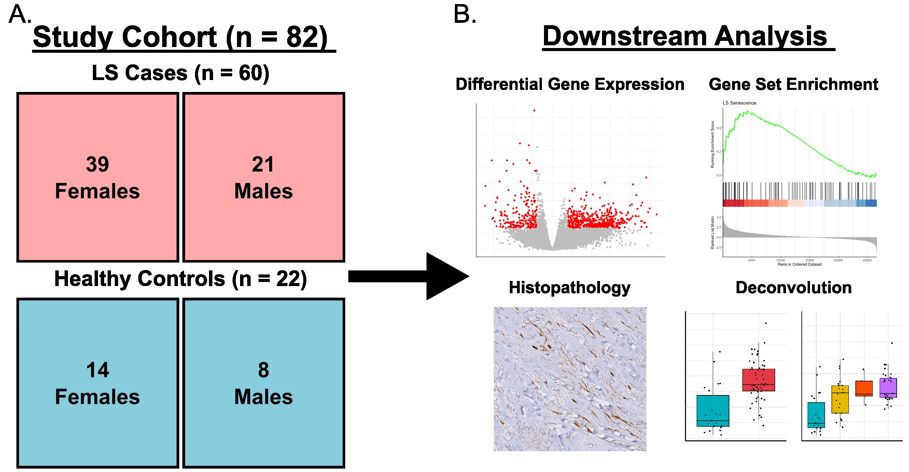

# Deconvolution analysis of Localized Scleroderma

This repository contains the analysis scripts for the deconvolution analyses performed in the study titled: 

_Interferon-driven T-cell activation and a senescence-associated signature characterize clinically active adult localized scleroderma_

Deconvolution was performed using the [SpaTM package](https://github.com/li-lab-mcgill/SpaTM).

## Analysis Pipeline

| Step | Script | Description |
| :--- | :--- | :--- |
| **1** | [`Final_GTM_Analysis.qmd`](./Final_GTM_Analysis.qmd) | Estimates and visualizes cell type abundance. |
| **2** | [`CTS_Deconvolution.qmd`](./CTS_Deconvolution.qmd) | Estimates cell-type-specific gene expression profiles. |
| **3** | [`CTS_DESeq2.qmd`](./CTS_DESeq2.qmd) | Performs cell-type-specific differential gene expression analysis with `DESeq2`. |
| **4** | [`ImmuneSignature.qmd`](./ImmuneSignature.qmd) | Computes and visualizes immune signature activity with respect to background gene expression. |

